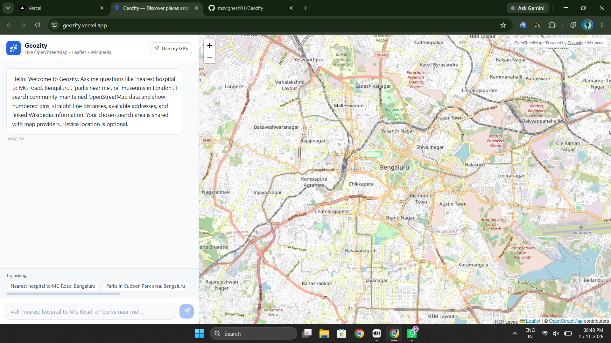
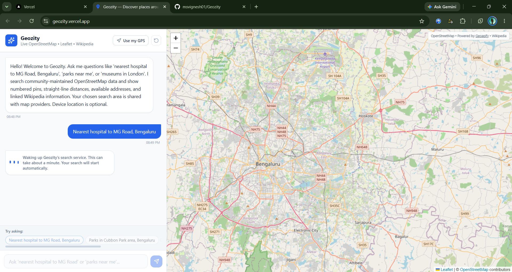
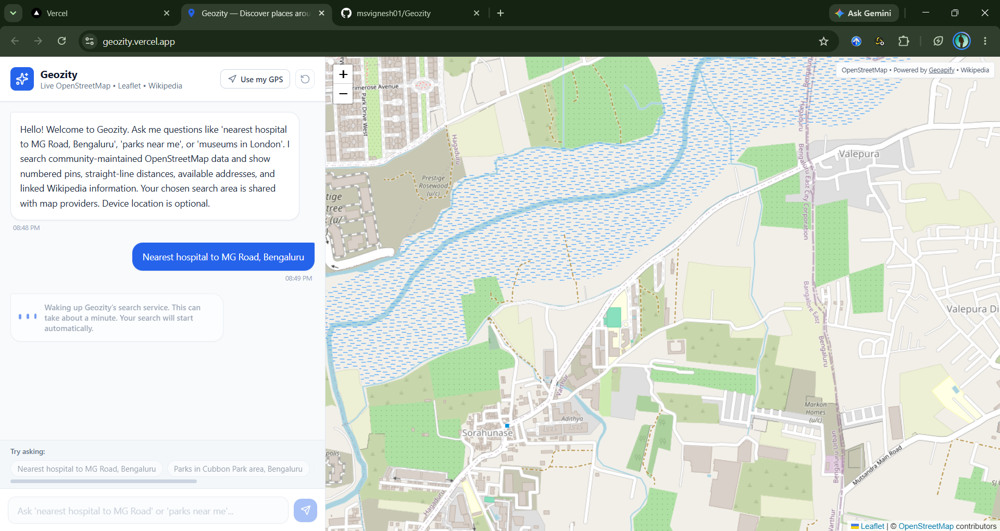
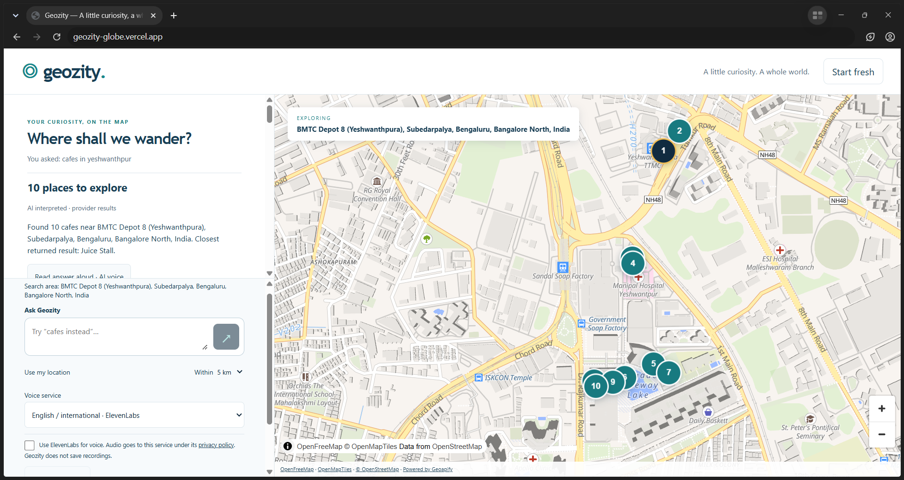
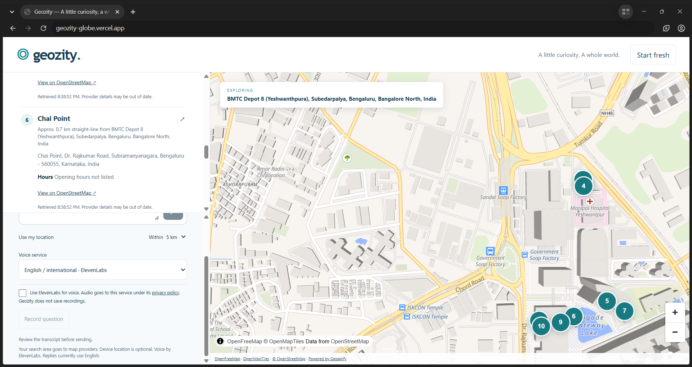

# Geozity product progression

These screenshots are grouped by their supplied V1 and V2 filenames. They show interface states, not proof that every planned feature or release check is complete. No release dates are inferred from them.

**Current checkpoint: stable Version 1 for the hackathon.** The screenshot labels describe the interface's development history. The current release scope is the existing globe, live search, place details and optional voice; the long-term outing planner and further voice/social work are paused until the owner asks to resume.

## V1 — chat beside a street map

The earlier interface presents a welcome message, sample questions, optional GPS and a Leaflet street map of Bengaluru.

A hospital question appears in the conversation while the interface says the search service is waking up.

The next two supplied images show a closer map view while that waiting message remains visible. They do not show completed hospital results.

## V2 — Geozity exploration and place details

The newer interface shows Geozity branding, a cafe search around Yeshwanthpur, a result summary, matching numbered map pins, and the Start fresh control. Voice provider selection and an unchecked consent box are visible.

The second V2 image shows the place list scrolled to Chai Point, including a straight-line distance, address, missing-hours notice, source link and retrieval time. Voice consent and transcript-review guidance remain visible.

The newer project lives in `globe/`; the earlier React/Flask application remains in `frontend/` and `backend/`. These images do not establish completion of the outing planner, real-device testing or human voice acceptance checks.

[Back to README](README.md)
