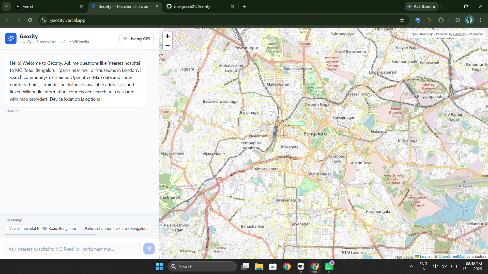
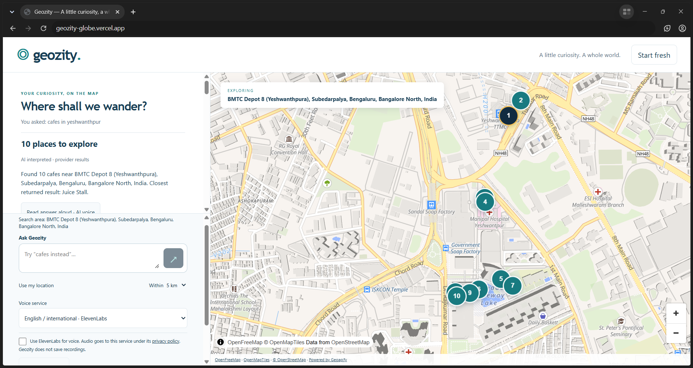

# Geozity

Ask for nearby hospitals, parks, cafes, restaurants, pharmacies, museums, attractions, libraries, or supermarkets. The application resolves a named area or an optional device location, searches live OpenStreetMap records, and shows matching numbered map pins and place cards. Follow-up questions can reuse the search area. Distances are approximate straight-line distances, not travel times. Addresses and hours are community-supplied and may be missing or outdated.

## Geozity product progression

The deployed **Version 1 hackathon release** provides the globe, live place search, place details and optional voice features. The **`h1-h2-h3` branch** adds outing drafts, route and opening-window checks, targeted stop edits and expanded voice controls. Those changes are tested locally and are not released to production. Live-provider, phone and human acceptance gaps remain explicit; social features remain later horizons.

The supplied screenshots use **V1** and **V2** to label interface development stages. Those labels do not mean that two complete product releases have shipped.

| Earlier chat-and-map interface                                                          | Newer Geozity exploration interface                                             |
| --------------------------------------------------------------------------------------- | ------------------------------------------------------------------------------- |
|  |  |

See the [full screenshot progression](PRODUCT_PROGRESSION.md) for all six supplied images and descriptions of what each shows. [Open the current globe preview](https://geozity-globe.vercel.app).

## Current Version 1 app

The current app lives in `globe/`: a React/MapLibre website on Vercel, a Cloudflare API, Supabase usage protection, live Geoapify places, optional Wikipedia details and direct Sarvam/ElevenLabs voice. DeepSpace is not required. Voice transcripts are reviewed before search; answers currently use English. Distances are straight-line, not travel times.

From the repository root, prepare only missing credentials in the existing `.env.local` using `.env.example`, then run:

```powershell
Set-Location globe
pnpm install --frozen-lockfile
pnpm dev
```

Open http://127.0.0.1:8780/. Supabase's usage function must already be initialized in the intended project. Local use consumes real provider/database capacity. AI/voice default off in samples; keys alone do not enable them. See [setup](docs/developer-setup.md) and [configuration](docs/configuration.md).

Inside `globe/`, repeatable checks are `pnpm test`, `pnpm typecheck`, `pnpm format:check`, `pnpm build` and `pnpm test:browser`. The current source passed 104 unit/integration tests and 42 controlled desktop/mobile browser cases. Live checks are separate and may consume credits. [Verification](docs/verification.md) distinguishes recorded results from pending physical-phone/human voice checks; passing checks do not certify full H1–H3 acceptance.

### Source and hosting names

The initial globe work was merged into GitHub `main` in commit `90c3c42`; the later guides were merged in `ebb7c01`. This implementation is published separately on **`h1-h2-h3`**, without a `codex/` prefix. Version 1 names the deployed hackathon checkpoint; V1/V2 screenshot labels name interface stages. Branch publication does not merge this work into `main` or update the separately deployed Worker.

| Vercel project  | Folder      | Website                                                   | Server         |
| --------------- | ----------- | --------------------------------------------------------- | -------------- |
| `geozity-globe` | `globe/`    | [Current hackathon app](https://geozity-globe.vercel.app) | Cloudflare     |
| `geozity`       | `frontend/` | [Earlier app](https://geozity.vercel.app)                 | Render / Flask |

Both Vercel projects are in Vicky's Workspace and build different applications from the same repository. A Git push can trigger Vercel preview builds; those previews still forward to the existing Worker, so they do not establish live planner support. Both existing projects remain in place. This branch does not change domains, delete projects or deploy the Worker.

See the [documentation index](docs/index.md), [user guide](docs/user-guide.md), [API reference](docs/api-reference.md) and [operations runbook](docs/operations-runbook.md).

## Earlier React/Flask app reference

The following instructions apply only to `frontend/` and `backend/`, not `globe/`. Earlier local delivery notes are retained for context; current hosted inventory and operating guidance are above and in `docs/`.

## Start locally on Windows

The tested environment uses Python 3.11 and Node.js 24.17.0. The repository has a pnpm lockfile. No AI key is used by this earlier deterministic app.

For an existing setup, run from the project folder:

```powershell
.\scripts\start-local.ps1
```

Open **http://127.0.0.1:5000/**. This command checks and builds the website, then runs the search server and website together. Keep that terminal open; press Ctrl+C there to stop it. If port 5000 is already occupied, stop the other local instance first or set `$env:PORT` to an unused port before starting. The single-server address follows that port setting.

For a fresh setup, install the already-declared dependencies first:

```powershell
python -m venv backend/.venv
.\backend\.venv\Scripts\python.exe -m pip install -r backend/requirements.lock.txt
Push-Location frontend
pnpm install --frozen-lockfile
Pop-Location
.\scripts\start-local.ps1
```

`backend/requirements.lock.txt` records the exact installed Python package versions used during verification. `backend/requirements.txt` is the original minimum-version dependency list. No framework or library upgrade was performed during the repair.

## Use the product

1. Type **Museums in London** and send it. Results should appear as numbered cards and matching pins.
2. Type **Parks instead**. The search should stay around the same reference point.
3. Select a card or its title using the keyboard. Its matching pin opens. Selecting a pin highlights and scrolls to its card.
4. Clear conversational memory and type **Pharmacies near me** without enabling GPS. The assistant should request a location and display the medical-data caution.
5. Reply **in Bengaluru** to continue that pharmacy search. Alternatively, choose **Use my GPS**, grant permission if desired, and send **pharmacies near me** again.

Clearing conversational memory clears the reference location, pending category, current pins, and active response. Earlier conversation entries remain visible. Previously granted device coordinates remain in browser memory until the page is reloaded; clearing conversational memory does not revoke browser location permission. No conversation or account database exists.

A search can return an honest empty result, ask for a location, reject an unsupported category, report an unknown named location, or report a temporary service problem. These outcomes are distinct. A slow request stops waiting after 90 seconds. Clearing memory cancels the browser's request and ignores its late response; already-started external provider work may finish on the server.

## Verification

From the project root:

```powershell
# Repeatable checks: no external HTTP calls are allowed in these tests.
.\backend\.venv\Scripts\python.exe -m pytest backend -q

Push-Location frontend
pnpm test
pnpm typecheck
pnpm build
Pop-Location

# Separate real-provider checks: needs outbound internet and can fail during provider outages.
.\backend\.venv\Scripts\python.exe -m pytest backend/tests/test_live_osm.py --live -q -s

# Confirm installed Python dependencies agree.
.\backend\.venv\Scripts\python.exe -m pip check
```

The default server checks explicitly skip the live checks. Run the final command with `--live` to exercise real providers; skipping them is not evidence that live search works. The frontend tests use Node's built-in test runner and the existing TypeScript compiler. There is no configured standalone lint tool in this project; strict TypeScript checks reject unused frontend locals and parameters.

For controlled browser checks, see the local historical BROWSER_CHECKS.md. Its synthetic provider server is isolated under `backend/tests` and requires the explicit `--fixtures` flag. **Never use that entrypoint for the real product.** Normal startup uses `backend/app.py`, which queries real providers and never substitutes invented places.

## Development mode

Run the server in one terminal:

```powershell
.\backend\.venv\Scripts\python.exe backend/app.py
```

Run `pnpm dev` inside `frontend` in another terminal and open http://127.0.0.1:5173/. Vite forwards `/api` requests to loopback port 5000. `pnpm preview` also forwards API calls to port 5000. For a custom server port, use the single-server startup command above; the development proxy stays at port 5000.

## Moving parts and API

- `frontend/src`: React 18, TypeScript, Leaflet 1.9, Tailwind CSS, and Lucide icons. Leaflet CSS is bundled locally.
- `backend/app.py`: public read-only search API, local built-website entrypoint, input limits, stable errors, and request timing logs.
- `backend/services`: deterministic intent parsing, Nominatim geocoding/fallback, Overpass queries, Wikipedia/Wikidata enrichment, distance/address formatting, and bounded memory caches.
- `GET /api/health`: confirms the process is alive; does not prove external providers are available. `ai_mode` is `rule_based`.
- `POST /api/chat`: accepts `message` (1–1000 characters), optional `user_location` numeric latitude/longitude, optional `last_context` (`location_name`, numeric `lat`/`lon`, supported `category`), and optional `pending_category` from a `needs_location` response.
- Search results use `ready`, `needs_location`, `unsupported_category`, `location_not_found`, or `no_results`. Invalid requests return HTTP 400; oversized bodies return 413; provider/busy failures return 503; unexpected failures return 500. API errors contain `status: "error"` and a user-readable `reply`.
- Search radius is 5 km. At most ten named results are returned. Overpass requests at most 100 records before local sorting; its result order and OSM coverage do not guarantee the absolute nearest place exists in the returned set. Ways and relations use their reported center points.
- Wikipedia summaries are optional and only attached through an OSM Wikipedia tag or a Wikidata-to-English-Wikipedia link. A common business name alone is not treated as proof of article identity. A missing or unavailable article never becomes an invented summary.

## Configuration and operating limits

The root `.env` is optional. Its values are not committed. `PORT` controls the local server port; `NOMINATIM_URL` and `OVERPASS_URLS` allow replacing upstream provider URLs without editing source. The old `FLASK_ENV` and `OPENAI_API_KEY` examples are retained for compatibility and are not used by this application. They do not enable a language-model service.

Direct local startup binds to `127.0.0.1`; the Flask development server is not the hosted serving process. The earlier hosted app uses Vercel plus Render/Gunicorn and explicit allowed browser origins. It has no account or payment system and no application database. Those statements concern this earlier app only; the current globe uses Supabase usage counters.

Each provider cache holds at most 256 entries for 15 minutes, with copies to avoid cross-request mutation. Four searches may be active in one process; extra requests receive a busy response. Nominatim requests share a process-wide serialized gate with at least 1.1 seconds between starts. **This gate is not shared across multiple processes or machines.** Public services have limited capacity and no availability guarantee. Do not scale this app against free public endpoints as though they were a contracted enterprise service.

Operational logs include request method, status, duration, and provider failure type. The application does not deliberately log questions, precise coordinates, or response bodies. Public providers receive submitted search areas, and map tiles are loaded from OpenStreetMap in the browser. Device location is optional; a public release needs an owner-approved privacy notice and provider contact identity.

The historical [Option A plan](option_a_build_plan.md) describes the original proposal. Its body is retained as history, with a current-status note; it is not a delivery certificate. [PROJECT_MAP.md](PROJECT_MAP.md) records the survey and initial defects; [current verification](docs/verification.md) records observed delivery checks and remaining limits.

## Technical detail (optional)

Provider behavior was checked against the official [Nominatim usage policy](https://operations.osmfoundation.org/policies/nominatim/), [search API](https://nominatim.org/release-docs/latest/api/Search/), [response format](https://nominatim.org/release-docs/latest/api/Output/), and [Wikidata presentation API](https://www.mediawiki.org/wiki/API:Presenting_Wikidata_knowledge). In particular, Nominatim limits aggregate application traffic, requires identification and attribution, forbids autocomplete/systematic harvesting, and requires the operator's deliberate informed choice to use its public service. The configured endpoints and existing provider contact must be reviewed before public use.
