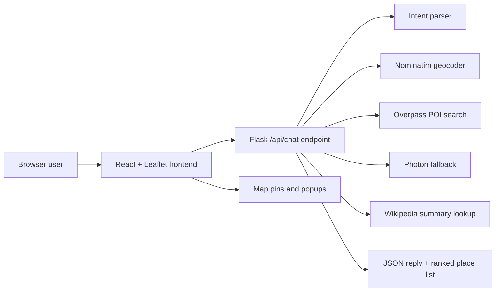

# Geozity

[](https://www.python.org/)
[](https://flask.palletsprojects.com/)
[](https://react.dev/)
[](https://www.typescriptlang.org/)
[](https://vitejs.dev/)
[](https://leafletjs.com/)
[](https://www.openstreetmap.org/)

Geozity is a browser-based place finder for nearby services and landmarks. A user asks for a category such as "hospitals," "parks," or "cafes," and the app resolves a city or location, queries live OpenStreetMap data, ranks the closest matches by distance, and optionally shows a short Wikipedia summary for the result.

The current implementation is intentionally simple and deterministic. It does not use a hosted AI model or a database. The backend is a Flask service that parses the request, resolves the search area, calls OpenStreetMap-based providers, and returns a JSON response to the frontend.

## Product snapshot

- Search categories: hospitals, parks, cafes, restaurants, pharmacies, museums, attractions, libraries, and supermarkets.
- Search locations: GPS coordinates, an explicit city or neighborhood, or a remembered previous search.
- Result data: ranked place list, straight-line distance, address, opening hours, phone, website, OpenStreetMap URL, and optional Wikipedia article summary.
- Safety behavior: emergency categories (hospitals and pharmacies) include an explicit safety notice.
- No login system: the app has no account, admin panel, or role model in the codebase.

## Project map

- `backend/`: Flask API, OpenStreetMap provider clients, safety checks, and tests.
- `frontend/`: React + TypeScript single-page app and map UI.
- `scripts/start-local.ps1`: local startup script for the Python virtual environment and frontend build.
- `Dockerfile`: container build for frontend and backend.
- `render.yaml`: Render deployment configuration.
- `.env.example`: sample environment configuration. It is not a secret file.

## Architecture at a glance



## Getting started

### Prerequisites

- Python 3.11+
- Node.js 20+ and pnpm 12+
- Windows PowerShell for the bundled startup script

### Local setup

1. Create the backend virtual environment and install dependencies.
2. Install the frontend dependencies with `pnpm install --frozen-lockfile` inside `frontend/`.
3. Run `scripts/start-local.ps1` from the repository root.

The bundled script expects:

- `backend/.venv/Scripts/python.exe` to exist
- `frontend/node_modules/vite/bin/vite.js` to exist

If those are missing, it stops with a clear error instead of starting the app partially.

### Local start command

```powershell
cd C:\Users\HP\Documents\GitHub\Geozity
pwsh ./scripts/start-local.ps1
```

The script validates the frontend TypeScript build and Vite build before starting the Flask app. The app is served at `http://127.0.0.1:5000/` by default.

## Documentation index

- [Documentation index](docs/index.md)
- [Architecture](docs/architecture.md)
- [User guide](docs/user-guide.md)
- [Developer setup](docs/developer-setup.md)
- [Project structure](docs/project-structure.md)
- [Configuration reference](docs/configuration.md)
- [API reference](docs/api-reference.md)
- [Operations runbook](docs/operations-runbook.md)
- [Contributing guide](docs/contributing.md)

## What is not present

This repository does not currently contain:

- a database layer or ORM
- user accounts or admin authentication
- scheduled background jobs
- webhook receivers or queue workers
- server-side persistence beyond in-memory request caching
- a separate documentation site or publishing system

## Support and operational notes

The app relies on public upstream map providers and may fail when those providers are slow, unavailable, or rate-limited. The backend is designed to prefer Overpass, fall back to Nominatim and Photon, and report an honest error when the service cannot complete a search. See the runtime and operations documentation for expected failure modes and recovery steps.

## License note

This repository does not currently include a license file. If the project is intended for public distribution or reuse, add the appropriate license before publishing externally.
