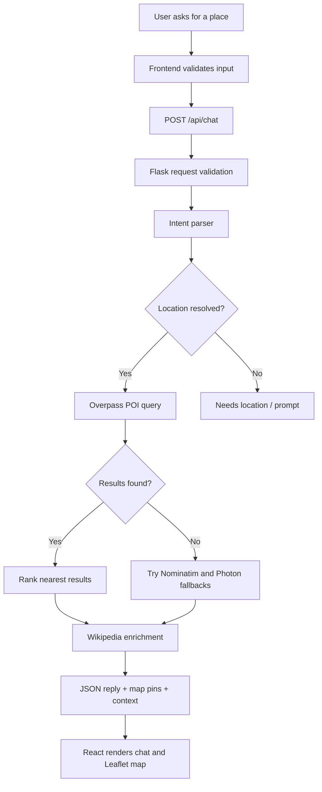

# Architecture

## System overview

Geozity is a single-page web application that searches for nearby places using public OpenStreetMap and Wikipedia data. The frontend is a React app that renders the conversation panel and map, while the backend is a Flask service that interprets user intent, resolves locations, queries provider APIs, and returns a structured JSON result.

There is no application database and no persisted user state in the repository. The only durable state is the in-memory cache inside the Flask process and the static frontend bundle.

## High-level flow

## Frontend

The frontend lives in `frontend/` and uses Vite as the build system. Its responsibilities are:

- capturing the user query
- showing the assistant conversation
- requesting device GPS when the user chooses it
- rendering the map with Leaflet
- selecting a result pin to show details
- keeping a short conversational memory for the last location/category pair

The app is not multi-page in the usual server-rendered sense. It is a single React shell with a chat panel on the left and a map on the right.

## Backend

The backend is defined by `backend/app.py` and the service modules under `backend/services/`.

### Main request path

1. The client calls `POST /api/chat` with a JSON body.
2. `parse_chat_request()` validates the message, coordinates, and prior context. Invalid input returns `400`.
3. `IntentParser.parse_query()` classifies the request and decides whether the user needs a location or whether a category follow-up should reuse the previous context.
4. If needed, it geocodes the city or place name through Nominatim or Photon.
5. It queries OpenStreetMap POIs via Overpass, using Nominatim POI search as a fallback.
6. It ranks the results by straight-line distance and adds a brief Wikipedia summary when the OSM record includes a `wikipedia` or `wikidata` tag.
7. It returns the final JSON payload with `status`, `reply`, `resolved_location`, `context`, and `places`.

## Provider stack

### Nominatim

Used for geocoding location names and as a fallback POI search when Overpass is empty or unavailable.

Key implementation points:

- `backend/services/nominatim_client.py`
- rate-limited with a shared request gate
- user agent string is set for the upstream request
- results are cached with a short TTL

### Overpass

Used as the primary live POI source for category searches.

Key implementation points:

- `backend/services/overpass_client.py`
- builds queries using OSM tags from `CATEGORY_TAGS`
- tries multiple public Overpass endpoints
- stops searching once a valid payload is returned and avoids treating empty results as a service outage

### Photon

Used as an OSM fallback site for geocoding and fallback place search.

Key implementation points:

- `backend/services/photon_client.py`
- rate-limited via a shared lock
- validates point geometry and provider payloads before creating place objects

### Wikipedia / Wikidata

The service enriches the top result set with article summaries for mapped places that include `wikipedia` or `wikidata` tags.

Key implementation points:

- `backend/services/wiki_client.py`
- fetches article summaries from the Wikipedia REST API
- falls back to the `enwiki` sitelink when a Wikidata tag is present

## Safety and failure handling

The backend clearly distinguishes between:

- an empty but valid result set
- an upstream outage
- a bad or invalid user request
- an unknown place name

The common error modes are represented in the API response with a `status` field and explicit messages rather than silent empty responses.

The app includes a safety notice for hospital and pharmacy category searches. The notice tells the user to use local emergency services in a medical emergency.

## Deployment model

The repository includes:

- `Dockerfile` for a two-stage container build
- `render.yaml` for a Render web service using the Docker image
- `backend/gunicorn.conf.py` for a single-worker, multi-threaded Gunicorn configuration

The runtime container serves the built frontend from `frontend/dist` and the Flask app exposes the website and API under the same host.

## Notable architecture constraints

- There is no database, so no user history is stored beyond the browser session.
- The search request gate is shared across providers to avoid overlapping upstream traffic at high concurrency.
- The app intentionally keeps category handling deterministic and rule-based, which is seen in the `health` endpoint as `"ai_mode": "rule_based"`.
- The frontend and API share a host origin, which is why the backend config includes `ALLOWED_ORIGINS` but still defaults to a safe, minimal CORS policy.
